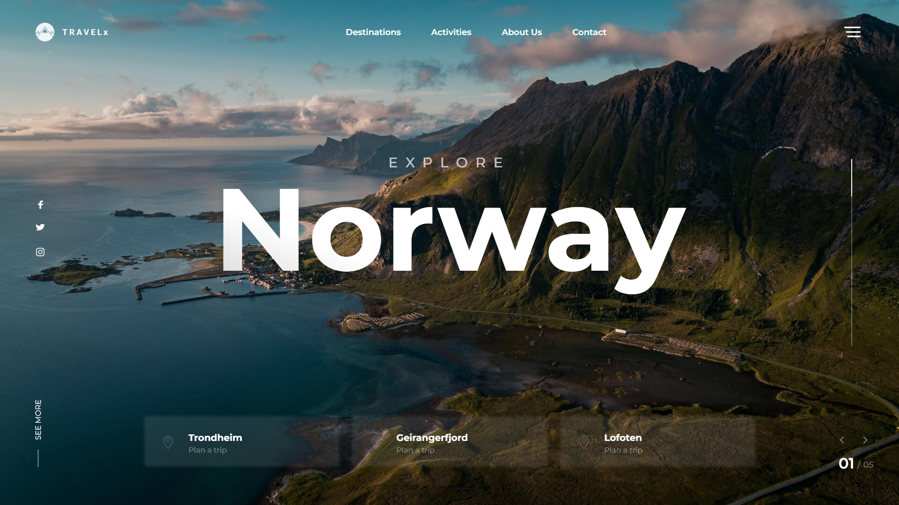
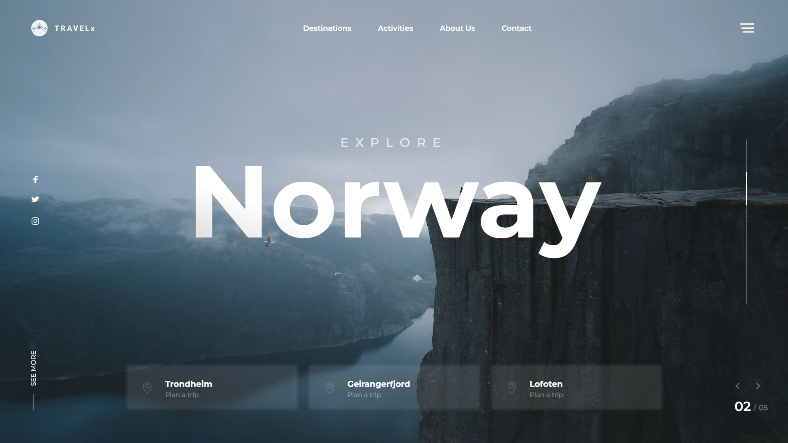
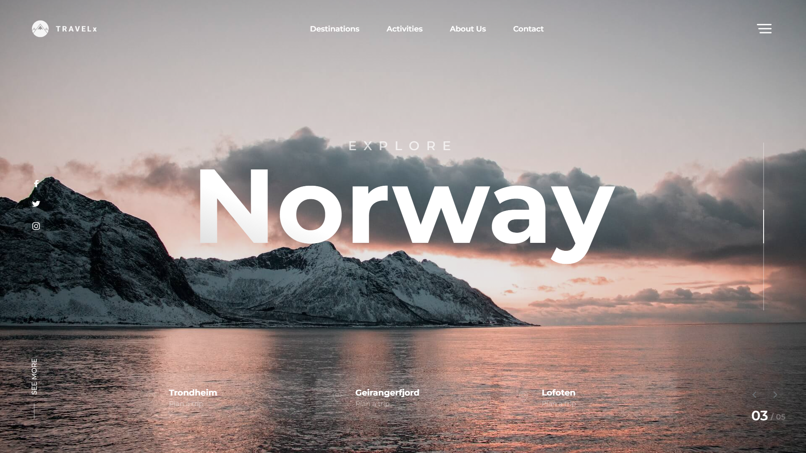
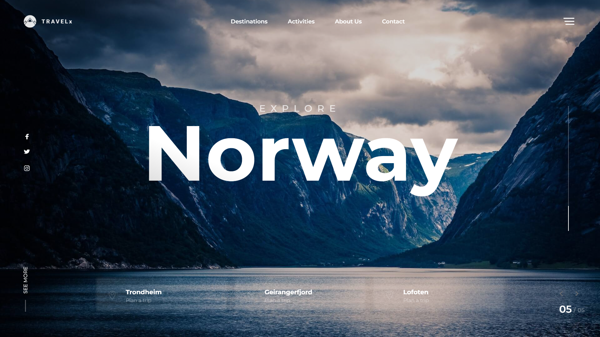
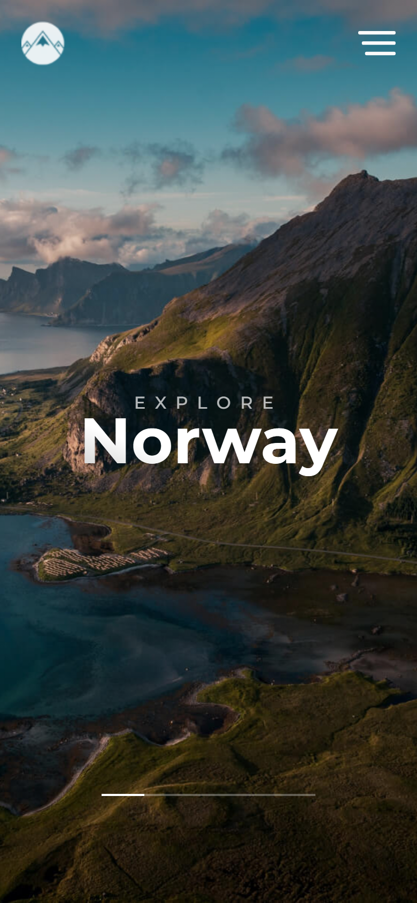

<h1 align="center">Norway</h1>

<p align="center">
  <b>Лендинг путешествий по Норвегии: полноэкранный слайдер, меню и подсказки маршрутов.</b>
</p>

<p align="center">
  
  
  
  
  <a href="https://dekciw.github.io/norway/"></a>
</p>

<p align="center">
  <a href="https://dekciw.github.io/norway/">
    
  </a>
</p>

<br>

<p align="center">
  
</p>

<br>

<table align="center">
  <tr>
    <th>&#8199;&#8199;&#8199;&#8199;&#8199;&#8199;Слайдер&#8199;&#8199;&#8199;&#8199;&#8199;&#8199;</th>
    <th>&#8199;&#8199;&#8199;&#8199;&#8199;&#8199;Шапка&#8199;&#8199;&#8199;&#8199;&#8199;&#8199;</th>
    <th>&#8199;&#8199;&#8199;&#8199;&#8199;&#8199;Вёрстка&#8199;&#8199;&#8199;&#8199;&#8199;&#8199;</th>
  </tr>
  <tr>
    <td valign="top">
      - Пять фото на весь экран<br>
      - Автопрокрутка<br>
      - Стрелки вперёд и назад<br>
      - Счётчик слайдов 01 / 05<br>
      - Индикатор текущего слайда<br>
      - Библиотека tiny-slider
    </td>
    <td valign="top">
      - Логотип TRAVELx<br>
      - Меню навигации<br>
      - Кнопка доп. меню<br>
      - Ссылки на соцсети<br>
      - Подсказки маршрутов<br>
      - Кнопка See more
    </td>
    <td valign="top">
      - Адаптив до телефона<br>
      - Четыре точки адаптива<br>
      - Шрифт Montserrat<br>
      - HTML, CSS и JavaScript<br>
      - Без сборки<br>
      - Сайт на GitHub Pages
    </td>
  </tr>
</table>

<h3 align="center">Как это выглядит</h3>

<table align="center">
  <tr>
    <td width="50%" align="center" valign="top">
      <br>
      <sub>Слайд 2 из 5</sub>
    </td>
    <td width="50%" align="center" valign="top">
      <br>
      <sub>Слайд 3 из 5</sub>
    </td>
  </tr>
  <tr>
    <td width="50%" align="center" valign="top">
      <br>
      <sub>Слайд 5 из 5</sub>
    </td>
    <td width="50%" align="center" valign="top">
      <br>
      <sub>Мобильная версия</sub>
    </td>
  </tr>
</table>

<br>

<details>
<summary><b>Подробнее о проекте: устройство, запуск</b> (нажми, чтобы развернуть)</summary>

<br>

### Структура

```
.
├── index.html                 # шапка со слайдером, меню, заголовок и подсказки маршрутов
├── css/
│   ├── reset.css              # сброс стилей браузера
│   └── main.css               # оформление и адаптив под 1670, 1140, 800 и 640 px
├── js/main.js                 # запуск слайдера, стрелки и счётчик слайдов
├── libs/tiny-slider/          # библиотека слайдера
├── img/                       # фото для слайдов, логотип, иконки и соцсети
└── assets/                    # скриншоты для README
```

### Как работает слайдер

<p>
- <b>tiny-slider</b> показывает пять фото по одному и листает их автоматически<br>
- <b>Стрелки</b> в правом нижнем углу вызывают <code>slider.goTo('prev')</code> и <code>slider.goTo('next')</code><br>
- <b>Счётчик</b> обновляется по событию <code>indexChanged</code> и показывает номер слайда в формате 01 / 05
</p>

### Запуск

Сборка не нужна: откройте `index.html` в браузере. Шрифт Montserrat подгружается из Google Fonts, без интернета страница покажется системным шрифтом.

</details>
